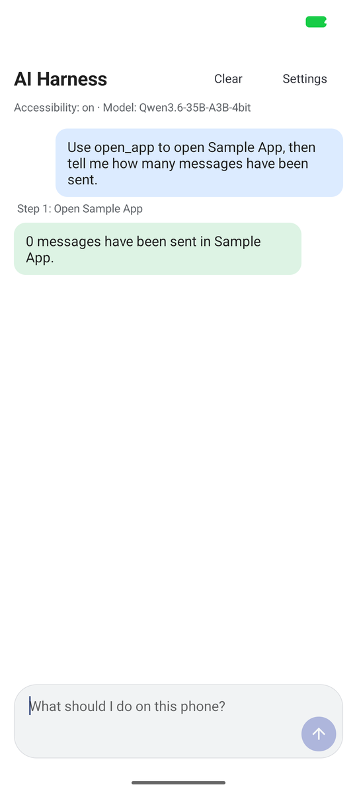
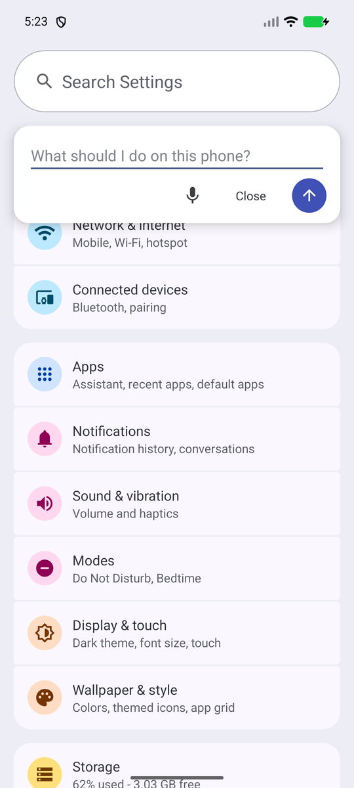

# 🤖📱 AssistDroid
**Give an AI agent the wheel — safely.**

An Android app that lets an AI agent operate your phone. You type (or dictate) a task, an OpenAI-compatible
language model chooses the next tap, scroll or text entry, and the app carries it out through Android's
accessibility service, behind a safety layer that asks you before anything irreversible.

> **Status: experimental.** Built for personal use first, on one emulator and one phone model; the design and
> the safety model are documented, but expect rough edges. See [Open-source readiness](docs/open-source-readiness.md)
> for what's done and what's still open.

---

<p>
  
  
</p>

---

## 🚀 Features

- 🧠 **On-device agent** – observe the screen, ask the model for one tool call, act, repeat. Screen text and screenshots stay in the app; only the model endpoint you configure receives them.
- 🔌 **Any OpenAI-compatible endpoint** – a server on your own network (Ollama, llama.cpp, vLLM, LM Studio, omlx, …) or a hosted API. Plain HTTP is allowed only to local or Tailscale hosts.
- 🛡️ **Safety layer enforced in code, not prompted for** – apps holding money or credentials are blocked; send/post/delete/buy/call taps wait for your on-screen approval; password fields are never typed into; an audit log skips screen and typed text; Stop is always one tap away ([ADR 0002](docs/decisions/0002-security-model.md)).
- 📬 **Read without operating apps** – an opt-in notification and email digest lets the agent summarise messages without ever opening a messaging app ([guide](docs/inbox-digest.md)).
- 🎙️ **Voice input** (optional, off by default) – Google speech or an on-device Whisper model, downloaded only if you enable it ([guide](docs/voice-input.md)).
- 🎈 **Floating button**, per-app **playbooks**, a guided **setup checklist**, and a **Developer** screen that exports a redacted diagnostics report.
- 🔬 **Measure, don't camouflage** – [Bot Lab](https://github.com/e-Garcia/botlab) (separate repo) measures what any app can observe about how it's being operated. Nothing here is built to defeat that ([ADR 0006](docs/decisions/0006-detectability-measure-not-camouflage.md), [non-goals](docs/non-goals-detection-bypass.md), [results](docs/detectability.md)).

---

## 🚫 What it is not

- Not a way to evade apps' automation checks, and not a tool for bulk or covert activity. Automating an app can violate its terms of service; that risk is yours.
- Not an iOS project (iOS has no equivalent cross-app accessibility API).
- Not published on Google Play (Play restricts autonomous use of accessibility services); it is sideloaded.

---

## 🧰 Installation

Requirements: JDK 17, Android SDK with NDK 28.2 and CMake 3.22 (SDK Manager), an emulator (Google APIs image, API 34+) or a phone.

```bash
./gradlew :android-harness:testDebugUnitTest :android-harness:assembleDebug :sample-app:assembleDebug
adb install -r android-harness/build/outputs/apk/debug/android-harness-debug.apk
adb install -r sample-app/build/outputs/apk/debug/sample-app-debug.apk
```

Open **AssistDroid**: the setup checklist walks you through the accessibility service (Android 13+ needs "Allow
restricted settings" first), notification and battery settings, and your model (base URL, model name, API key).
Then try: *"Open the Settings app and tell me the Android version."* Details and Samsung notes: [docs/setup.md](docs/setup.md).

From a computer, `scripts/` has adb helpers (configure the model, run a task, set policy). A driven mode (local
HTTP API behind a bearer token, reached through `adb forward`) is described in [docs/requirements.md](docs/requirements.md).

---

## 🧪 Status

| Area | Status | Notes |
|---|---|---|
| On-device agent loop | ✅ Implemented | Chat UI + foreground service, 30-step default limit, stuck detection |
| Safety layer (confirm gate, denylist, audit log) | ✅ Implemented | Enforced in `PolicyAutomation`, not by the model |
| Voice input | ✅ Implemented, optional | Google speech or local Whisper (whisper.cpp, CPU only) |
| Notification / email digest | ✅ Implemented, opt-in | Read-only; not yet verified against a real mail provider |
| Real-device validation | 🛠️ In progress | Verified on one emulator image; Samsung Galaxy Z Fold 4 pending |
| Bot Lab (detectability measurement) | 🔗 Split into [its own repo](https://github.com/e-Garcia/botlab) | Human baseline session not yet recorded |
| Google Play distribution | 🔜 Not planned | Play policy restricts autonomous accessibility use; sideload-only by design |

---

## 🏗️ How it is built

Native Kotlin, plain Android Views (no Compose or AndroidX in the main app), Ktor for the model client and the
optional local server, whisper.cpp (vendored, CPU only) for on-device speech. `Automation` is the interface the
agent uses; `AccessibilityAutomation` implements it and `PolicyAutomation` wraps it so **every action passes
through the safety layer**. Start with [docs/requirements.md](docs/requirements.md) and the
[ADRs](docs/decisions/); the history is in [docs/development-log.md](docs/development-log.md).

---

## 📜 License

MIT — see [LICENSE](LICENSE). Third-party licenses are listed in [THIRD_PARTY_NOTICES.md](THIRD_PARTY_NOTICES.md).

---

## ✨ Contributing and security

Issues, discussion and bug reports are welcome — see [CONTRIBUTING.md](CONTRIBUTING.md) (including what will not
be accepted; large PRs are asked to wait until contribution terms are settled). An accessibility service can
read the screen and act as you, so please report vulnerabilities privately: see [SECURITY.md](SECURITY.md).

---

## 📈 Roadmap

- [x] MIT license
- [x] Package renamed to the `dev.egarcia.*` convention
- [x] Bot Lab split into its own repository
- [x] Project named: AssistDroid (checked against GitHub, Play Store and general web)
- [ ] Real-device validation (Samsung Galaxy Z Fold 4): setup, approval dialog, keep-awake, floating button, voice, digest
- [ ] Human baseline session in Bot Lab
- [ ] Signing key, release build, tagged APK with checksums and provenance
- [ ] Decide contribution terms (DCO or CLA)

Full list: [docs/open-source-readiness.md](docs/open-source-readiness.md).

---

## 🧑‍💻 Maintainer

Developed and maintained by [Erick Garcia](https://github.com/e-Garcia).

_Last updated: October 16, 2026_
